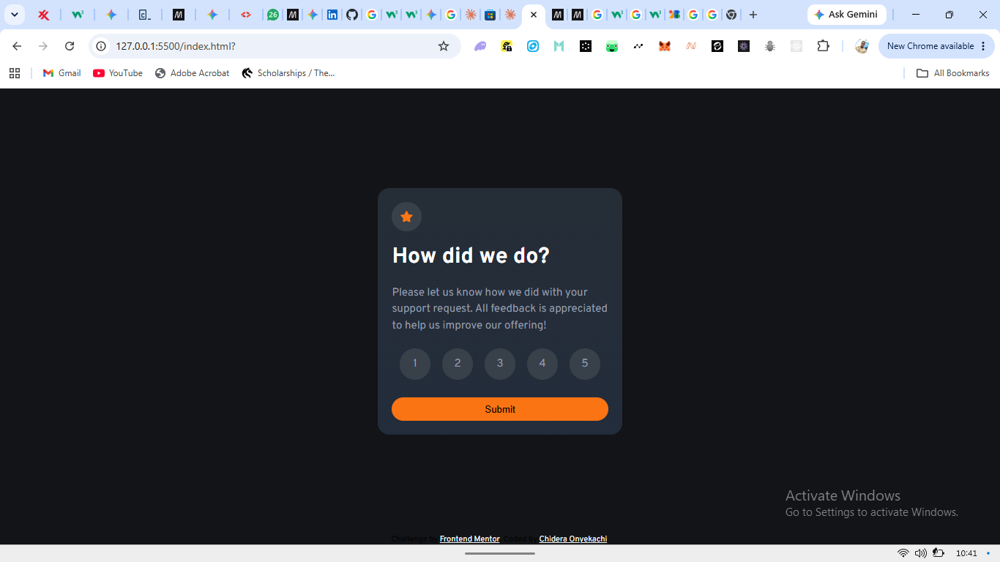
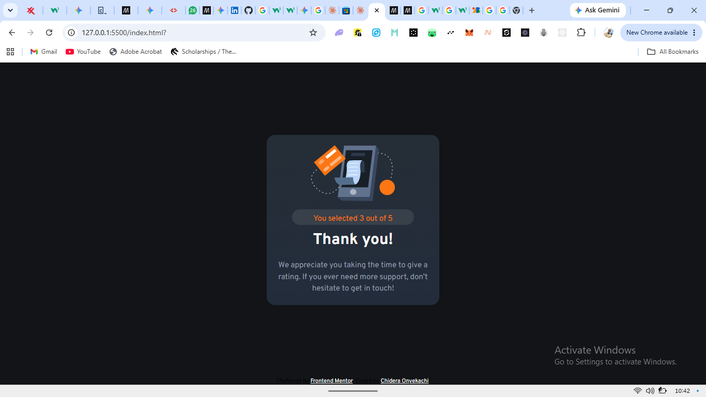
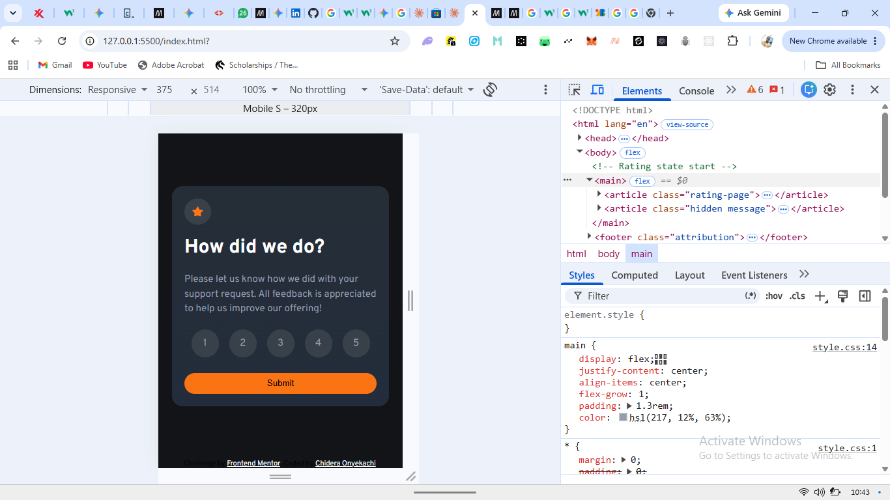

# Frontend Mentor - Interactive rating component solution

This is a solution to the [Interactive rating component challenge on Frontend Mentor](https://www.frontendmentor.io/challenges/interactive-rating-component-koxpeBUmI). Frontend Mentor challenges help you improve your coding skills by building realistic projects.

## Table of contents

- [Overview](#overview)
  - [The challenge](#the-challenge)
  - [Screenshot](#screenshot)
  - [Links](#links)
- [My process](#my-process)
  - [Built with](#built-with)
  - [What I learned](#what-i-learned)
  - [Continued development](#continued-development)
  - [Useful resources](#useful-resources)
  - [AI Collaboration](#ai-collaboration)
- [Author](#author)
- [Acknowledgments](#acknowledgments)

**Note: Delete this note and update the table of contents based on what sections you keep.**

## Overview






### The challenge

Users should be able to:

- View the optimal layout for the app depending on their device's screen size
- See hover states for all interactive elements on the page
- Select and submit a number rating
- See the "Thank you" card state after submitting a rating

### Screenshot


### Links

- Solution URL: [Add solution URL here](https://your-solution-url.com)
- Live Site URL: [https://church2000.github.io/interactive-rating-component/](https://church2000.github.io/interactive-rating-component/)

## My process

### Built with

- Semantic HTML5 markup
- CSS custom properties
- Flexbox
- CSS Grid
- Mobile-first workflow
- JS

### What I learned

```html

```

```css
.proud-of-this-css {
  input:checked + label {
    background-color: hsl(0, 100%, 100%);
    color: hsl(213deg 14.35% 25.47%);
  }
  input:focus-visible + label {
    background-color: hsl(0, 100%, 100%);
    color: hsl(213deg 14.35% 25.47%);
    outline: 2px solid hsl(213, 19%, 18%);
    outline-offset: 5px;
  }
}
```

```js
{
I leanrt how forms are been validated
how to make use of name attribute
};
```

If you want more help with writing markdown, we'd recommend checking out [The Markdown Guide](https://www.markdownguide.org/) to learn more.

**Note: Delete this note and the content within this section and replace with your own learnings.**

### Continued development

I will still like to explore more on javascript.

### Useful resources

- [Font family](https://fonts.google.com/selection/embed) - This helped me to ensure that my font doesn't chamge no matter the device. I really liked this pattern and will use it going forward.

### AI Collaboration

- What tools did you use : Claude
- How did you use them :for debugging, brainstorming solutions.

## Author

- Website - [Linkedln](www.linkedin.com/in/paschal-chidera-498502286)
- Frontend Mentor - [@church2000](https://www.frontendmentor.io/profile/church2000)
- Twitter - [@church65100299](https://x.com/Church65100299)

## Acknowledgments

A special shoutout to:

- **Frontend Mentor** – for crafting realistic UI designs and building an inspiring community that helps developers grow through practical projects.
- **My Support System** – to everyone who provided words of encouragement, emotional grounding, and perspective when the learning curve was steep. Your unwavering belief in my process kept me energized.
- **Myself** – for showing up consistently, embracing the struggle of debugging, and choosing growth every single day.
